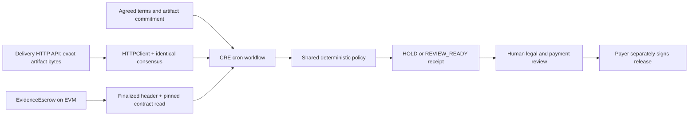

# Architecture and trust boundary

The UI supports synthetic fixtures and portable local evidence bundles through the shared policy. Local EVM scripts write a bundle containing terms, delivery bytes, snapshot, recorded evaluation time and receipt fingerprint. The browser validates and replays the bundle offline, explicitly marking its origin as unauthenticated and its result as historical. This does not verify a CRE signature. The CLI returns a receipt in logs; it does not push an authenticated report to the UI. A future integration needs signed report verification and provenance binding.

The immutable contract binds payer, beneficiary, amount, milestone ID digest, artifact hash, deadline and challenge period at deployment. Only payer acceptance starts the challenge timer; the untrusted delivery API cannot set acceptance. CRE checks the committed onchain terms before evaluating. It reads one finalized block height, avoiding accidental mixing of snapshots across blocks. The policy receipt binds both source and time; changes produce different commitments.

No workflow private key, payment function or autonomous legal interpretation exists in CRE. Final transaction execution rechecks contract state, preventing an old receipt from bypassing a newly opened dispute. The contract is a demonstration, lacks refund/arbitration paths, and is not ready to custody real funds.

## Threats exercised

| Threat | Control |
|---|---|
| Delivered artifact substituted | Recompute digest; compare against both terms and chain |
| API forges client acceptance | Ignore API acceptance; use onchain payer acceptance |
| Beneficiary or amount swapped | Compare against agreed terms |
| Conflicting HTTP bodies | Exact consensus, no averaging of document data |
| Dispute opened after review | Contract rechecks dispute during payer release |
| Replay/double payment | Receipt binds contract/chain/milestone; contract single-release guard |
| Missing provider, malformed state | Throw/hold; never manufacture ready evidence |
| Fixture mistaken for public proof | Source level is visible and included in receipt hash |

Production concerns include authenticated delivery and agreed document canonicalization, independent RPC trust, operational monitoring, private document handling, identity, dispute arbitration and recovery. Consensus establishes agreement on a response; it does not make a dishonest source truthful.
